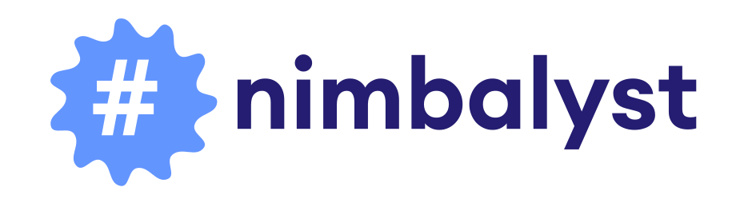
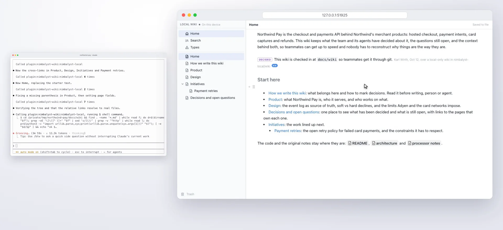
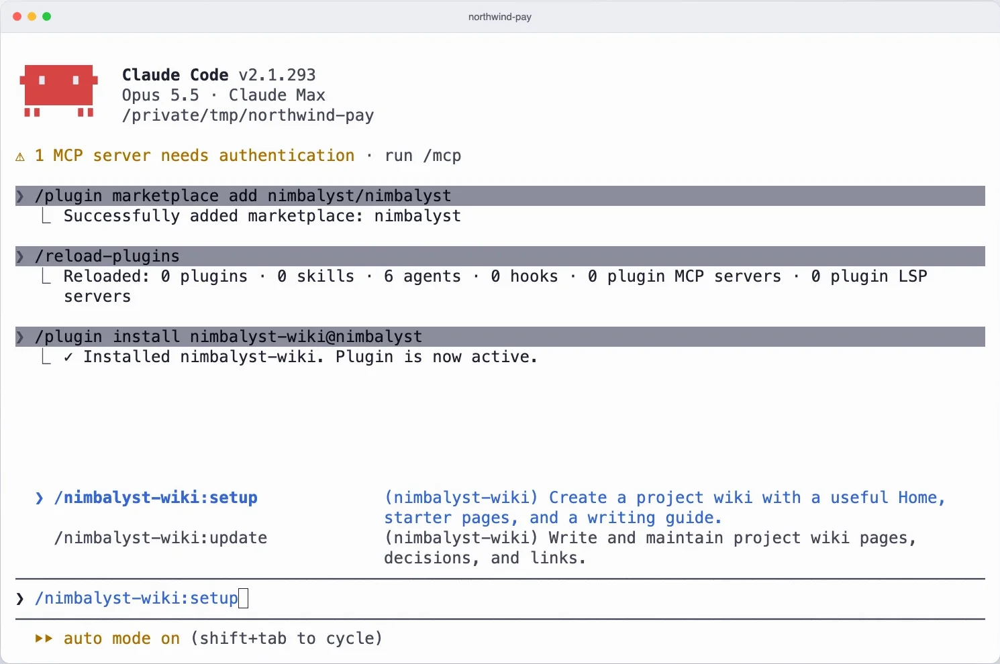
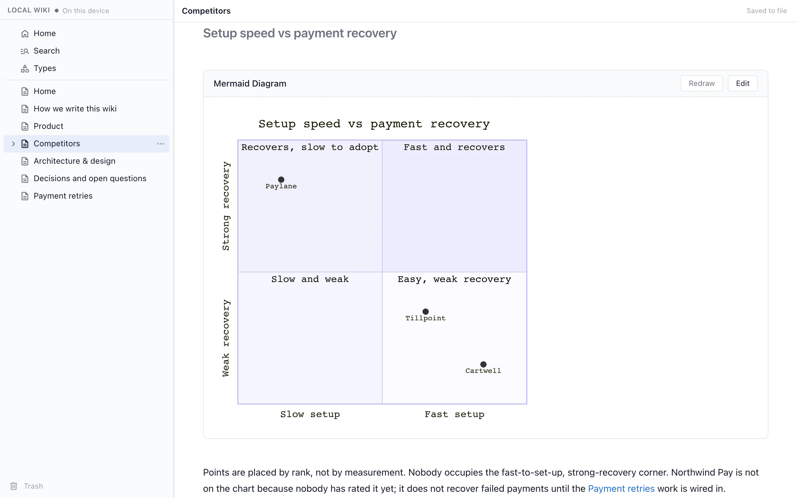
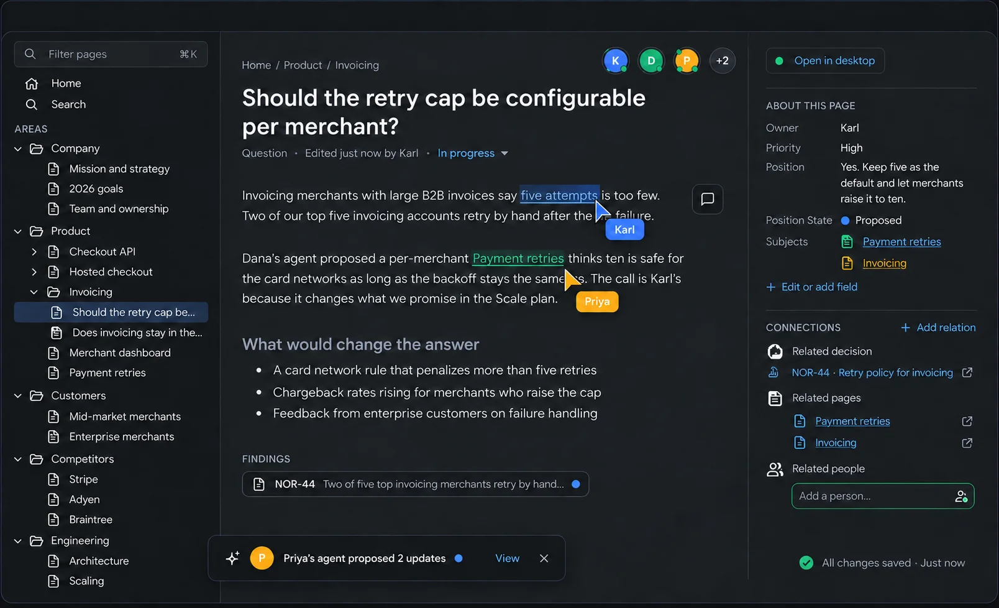

<p align="center">
  <a href="https://nimbalyst.com/wiki/coding-agents/">
    <picture>
      <source media="(prefers-color-scheme: dark)" srcset="docs/images/logo-dark.svg">
      
    </picture>
  </a>
</p>

<h1 align="center">Nimbalyst Wiki</h1>

<p align="center">
  <b>A local wiki your coding agents write for you, so you can think, organize, and set direction.</b>
</p>

<p align="center">
  A Claude Code and Codex plugin that turns your sessions into a markdown wiki in your repo,<br>
  with every decision recorded in the page it affects.
</p>

<p align="center">
  <a href="https://github.com/nimbalyst/nimbalyst-wiki/blob/main/.claude-plugin/plugin.json"></a>
  <a href="LICENSE"></a>
  <a href="#claude-code"></a>
  <a href="#codex"></a>
  <a href="#other-agents"></a>
  
</p>

<p align="center">
  <a href="#get-started"><b>Get started</b></a> &nbsp;·&nbsp;
  <a href="#watch-the-demo"><b>Demo</b></a> &nbsp;·&nbsp;
  <a href="#what-you-can-do"><b>Features</b></a> &nbsp;·&nbsp;
  <a href="#share-it-with-your-team"><b>Teams</b></a> &nbsp;·&nbsp;
  <a href="#reference"><b>Reference</b></a> &nbsp;·&nbsp;
  <a href="https://nimbalyst.com/wiki/coding-agents/"><b>Website</b></a>
</p>

<br>

<p align="center">
  <picture>
    <source media="(prefers-color-scheme: dark)" srcset="docs/images/hero-dark.webp">
    
  </picture>
</p>

Overwhelmed and disorganized working with agents? Your agent distills what you worked on into a wiki of plain markdown files: a Home page, the decisions you made and why, open questions with owners, and the things you track. You read and edit it in your browser, and every agent you use works on the same files.

<table>
  <tr>
    <td width="50%" valign="top"><b>Markdown files in your repo</b><br>Keep it private in <code>nimbalyst-local/wiki</code> or check it in under <code>docs/wiki</code>, and diff and commit it like code.</td>
    <td width="50%" valign="top"><b>Stays on your machine</b><br>A local wiki needs no account and no server, and the browser view listens on localhost only, behind a token.</td>
  </tr>
  <tr>
    <td width="50%" valign="top"><b>One wiki for every agent</b><br>Claude Code, Codex, Cursor, VS Code and Cowork use the same MCP tools on the same files.</td>
    <td width="50%" valign="top"><b>Open source</b><br>The plugin, the <code>nim</code> CLI, its MCP server and the browser app are MIT licensed.</td>
  </tr>
</table>

---

## Watch the demo

https://github.com/user-attachments/assets/95c89f65-98c8-461a-8429-0acefaa22c22

<p align="center">
  <sub>The wiki in Claude Code and your browser, from installing the plugin to editing a page.</sub>
</p>

---

## Get started

You need Node.js 22 or later on your `PATH`. You don't need the Nimbalyst app or an account.

### 1. Install the plugin

#### Claude Code

```
/plugin marketplace add nimbalyst/nimbalyst-wiki
/plugin install nimbalyst-wiki@nimbalyst-wiki
```

#### Codex

```sh
codex plugin marketplace add nimbalyst/nimbalyst-wiki
codex plugin add nimbalyst-wiki@nimbalyst-wiki
```

Using Cursor, VS Code, Cowork or the Codex app? See [Other agents](#other-agents).

### 2. Build the wiki

```
/nimbalyst-wiki:setup
```

Claude asks who the wiki is for, then writes a Home page, a writing guide and starter pages from your README and docs. In Codex, ask it to "set up a wiki for this repo."

<p align="center">
  <picture>
    <source media="(prefers-color-scheme: dark)" srcset="docs/images/setup-dark.webp">
    
  </picture>
</p>

### 3. Capture what you decided

```
/nimbalyst-wiki:capture
```

At the end of a session, capture writes each decision into the page it affects, with who decided, when and what was passed over, and records open questions with their owners. Claude Code reminds the agent once to capture after a session with a commit, a plan or several file edits.

### 4. Open it in your browser

Ask your agent to "open the wiki in my browser." You get the page tree and the page editor, with typed pages and type tables. Drawings, mind maps, spreadsheets, calc sheets, data models, mockups and canvases open in their own editors. Edits save straight to the files, and what your agent writes shows up live.

<p align="center">
  <picture>
    <source media="(prefers-color-scheme: dark)" srcset="docs/images/home-dark.webp">
    
  </picture>
</p>

> [!TIP]
> **Using Codex?** Codex does not run plugin hooks, so there is no end-of-session reminder; ask it to "record what we decided in the wiki." Session citations read Claude Code transcripts only, so decisions recorded from Codex carry your name but no quote.

---

## What you can do

<table>
  <tr>
    <td width="50%" valign="top">
      <h3>Decisions in the page they affect</h3>
      Each decision is marked with who decided, when and what was not chosen.
      <br><br>
      <picture>
        <source media="(prefers-color-scheme: dark)" srcset="docs/images/retries-dark.webp">
        
      </picture>
    </td>
    <td width="50%" valign="top">
      <h3>What is decided and what is still open</h3>
      An index page links to every decision and open question, so you can catch up in a few minutes.
      <br><br>
      <picture>
        <source media="(prefers-color-scheme: dark)" srcset="docs/images/decisions-dark.webp">
        
      </picture>
    </td>
  </tr>
  <tr>
    <td width="50%" valign="top">
      <h3>Track things with types</h3>
      Ask your agent to track competitors, customers or features. Each item gets its own page with your fields, and the type keeps a table of every item.
      <br><br>
      <code>Track our competitors in the wiki: category, threat, setup speed and payment recovery for each.</code>
      <br><br>
      <picture>
        <source media="(prefers-color-scheme: dark)" srcset="docs/images/types-dark.webp">
        
      </picture>
    </td>
    <td width="50%" valign="top">
      <h3>2x2s and diagrams in a page</h3>
      Ask for a 2x2, a flowchart or a sequence diagram and your agent draws it in the page, where you can edit it.
      <br><br>
      <code>Add a 2x2 of setup speed against payment recovery to the Competitors page.</code>
      <br><br>
      <picture>
        <source media="(prefers-color-scheme: dark)" srcset="docs/images/2x2-dark.webp">
        
      </picture>
    </td>
  </tr>
</table>

You can also just ask: "what does the wiki say about auth?", "add a page about our deploy process", "open the wiki in my browser".

---

## Open it in the Nimbalyst app

The same files open in the free, open-source [Nimbalyst app](https://nimbalyst.com/wiki/local/), with live tables, 2x2s, mockups and diagrams you edit in place, next to your sessions and code. Open **Wiki** in the navigation gutter (Cmd+D) and choose **Local**. Nothing moves: the app reads the same folder your agent writes to. Inside the app, agents already have the wiki tools, and the plugin stands aside so each page has one write path.

<p align="center">
  <picture>
    <source media="(prefers-color-scheme: dark)" srcset="docs/images/app-dark.webp">
    
  </picture>
</p>

---

## Share it with your team

When the wiki should be shared, move it to [Nimbalyst Teams](https://nimbalyst.com/wiki/teams/). You, your teammates and all of your agents then edit the same pages in real time, from the app or the browser, with comments and history. Teams is paid, and free during beta.

```
/nimbalyst-wiki:team
```

Claude walks you through it:

1. **Sign in.** Run `/mcp`, choose `nimbalyst-team` and Authenticate. A browser page opens where you sign in to Nimbalyst or create an account.
2. **Choose a team and project.** With no team yet, Claude proposes a name and creates the team, its first project and a Home page, connected to this repository's git remote. Already in a team? Connect to one of its projects or create a new one.
3. **Approve the move.** The local server signs in with the same account so pages go straight from your files to Nimbalyst. Claude opens the approval page and you confirm the code.
4. **Move.** Claude shows what will move, then moves pages, typed pages, types, hierarchy, order, fields and links in one step. If it is interrupted, running it again picks up where it stopped.
5. **Invite.** Claude opens the team wiki in your browser and can invite teammates by email, reading the list back to you first, or create an invite link.

Your local files are not deleted. Commit `.nimbalyst/wiki.json` so your teammates' agents find the same project. From a terminal, `nim login` and then `nim wiki move-to-team` (add `--dry-run` to preview) does the same move.

<p align="center">
  
</p>

<details>
<summary><b>If you were invited</b></summary>
<br>

An invite email or link signs you in to Nimbalyst in the browser and opens the team's wiki. You can read, edit and comment there with nothing installed.

To use the wiki from Claude Code too, install this plugin, run `/mcp`, choose `nimbalyst-team` and Authenticate with the same email. In Codex, run `codex mcp login nimbalyst-team`. If the repository has a committed `.nimbalyst/wiki.json`, your agent uses that team project right away; otherwise it finds the project through the repository's git remote.

</details>

---

## Reference

<details>
<summary><b>Skills</b></summary>
<br>

| Skill | What it does |
| --- | --- |
| `/nimbalyst-wiki:setup` | Builds the first version of the wiki: Home, the writing guide ("How we write this wiki") and starter pages. It can also define types. Running it again fills gaps and never duplicates or overwrites what people wrote. |
| `/nimbalyst-wiki:capture` | Records what this session decided, answered and left open, in the page each one affects. If nothing is worth keeping, it says so. |
| `/nimbalyst-wiki:team` | Moves the wiki to Nimbalyst Teams and invites teammates. See [Share it with your team](#share-it-with-your-team). |
| `/nimbalyst-wiki:start` | A short tour of the plugin. |
| `/nimbalyst-wiki:connect` | Chooses which wiki the session uses and connects a repository to a team project. Runs on its own when needed. |
| `/nimbalyst-wiki:update` | The writing guide the agent follows for every wiki edit. You rarely call it yourself. |

</details>

<details>
<summary><b>What the plugin installs</b></summary>
<br>

Three MCP servers, listed by `/mcp` in Claude Code and `codex mcp list` in Codex:

| Server | What it does |
| --- | --- |
| `nimbalyst-local` | The local wiki and its browser view. Runs on your machine and needs nothing else installed. When you move the wiki to a team, it signs in to Nimbalyst to copy the pages. |
| `nimbalyst-session` | Lets the agent cite what you typed in this session when it records a decision. Reads only this session's transcript, on your machine. |
| `nimbalyst-team` | The team wiki on the Nimbalyst server. Leave it disconnected if you only use a local wiki. |

</details>

<details>
<summary><b>Which wiki the agent uses</b></summary>
<br>

At the start of wiki work the agent decides once per session:

1. If you name one ("the team wiki", "the local wiki"), it uses that.
2. If the repository has a local wiki, it uses it. If the repository is also connected to a team project, it asks which.
3. Otherwise it checks for a team project connected to this repository's git remote. If there is none, it offers once to start a local wiki: private in this checkout, checked in under a folder you choose, or not now.

It never writes the same thing to both. Team data never goes through the local server.

</details>

<details>
<summary><b>How decisions are recorded</b></summary>
<br>

A decision is a marked sentence in the page it affects:

```markdown
[We store and evaluate flags in Flagship.]{decided by="Dana Lee" email=dana@example.com on=2026-09-30 over="our own Durable Object store"}
```

- Open questions use the same form with `open`.
- When your own words support a statement, the agent adds a citation copied from the session transcript. It never invents a decision, a reason or a quote.
- On a local wiki the name and email come from `git config user.name` and `git config user.email`.
- Set `NIMBALYST_WIKI_NUDGE_MIN_EDITS` to change how many edits trigger the capture reminder.

</details>

<details>
<summary><b>Updating the plugin</b></summary>
<br>

Once a day the plugin checks GitHub for a newer version, and if there is one, the agent mentions it the next time it uses the wiki. The check sends nothing about you or your wiki. Set `NIMBALYST_WIKI_NO_UPDATE_CHECK=1` to turn it off.

**Claude Code** updates this marketplace only if you turn on auto-update for it (`/plugin`, then Marketplaces). To update by hand, run both commands, then restart Claude Code:

```sh
claude plugin marketplace update nimbalyst-wiki
claude plugin update nimbalyst-wiki@nimbalyst-wiki
```

**Codex:** run `codex plugin marketplace upgrade nimbalyst-wiki` and start a new session.

**Coming from 0.3.0?** That version was installed from the `nimbalyst/nimbalyst` marketplace. Switch to this one so you get updates and the browser view, then restart Claude Code. Your wiki is files in your repository, so nothing in it changes.

```
/plugin uninstall nimbalyst-wiki@nimbalyst
/plugin marketplace remove nimbalyst
/plugin marketplace add nimbalyst/nimbalyst-wiki
/plugin install nimbalyst-wiki@nimbalyst-wiki
```

</details>

<details id="other-agents">
<summary><b>Other agents: Cursor, VS Code, Cowork, the Codex app, any MCP agent</b></summary>
<br>

These agents use the wiki through `nim mcp`, the same local server the plugin bundles. Install the `nim` CLI, then add the server to your agent's MCP config:

```sh
npm install -g @nimbalyst/cli
```

| Agent | Config file | Workspace argument |
| --- | --- | --- |
| Cursor | `.cursor/mcp.json` (key `mcpServers`) | `${workspaceFolder}` |
| VS Code, Copilot in agent mode | `.vscode/mcp.json` (key `servers`) | `${workspaceFolder}` |
| Cowork | The Claude desktop app's MCP config (key `mcpServers`) | `/path/to/your/project` |
| Codex app, any MCP client | Your client's MCP config | Your project path |

```json
{
  "mcpServers": {
    "nimbalyst-wiki": {
      "command": "nim",
      "args": ["mcp", "--workspace", "${workspaceFolder}"]
    }
  }
}
```

If the app cannot find `nim`, use the full path that `which nim` prints. Then ask the agent to "start a wiki for this repo." A wiki started in one agent is ready in the others.

These agents get the wiki tools but not the plugin's skills (`setup`, `capture` and the writing guide), so ask for what you want in your own words. To open the wiki in the browser from them, also install the browser app: `npm install -g @nimbalyst/wiki-web`.

</details>

<details>
<summary><b><code>nim</code> command line</b></summary>
<br>

For scripts and your own terminal. You don't need it to use the plugin. `nim wiki` works on both the local and the team wiki.

```sh
nim wiki init                         # create the wiki in nimbalyst-local/wiki (ignored by git)
nim wiki init --location docs/wiki    # or in a checked-in folder
nim wiki list                         # the page tree
nim wiki read "Product"               # a page by title, path or id
echo "..." | nim wiki write "Notes" --create
nim wiki search "deploy"
nim wiki move "Notes" --parent "Product"
nim wiki serve                        # open the wiki in your browser
nim wiki move-to-team --dry-run       # preview moving the local wiki to Teams
```

- `list`, `read`, `move` and `search` use the local wiki when the project has one, and the team wiki otherwise. `--team` or `--local` picks one.
- `write` replaces a page body from stdin or `--file`. With `--expected-version` (from `read --json`) it refuses to overwrite a page that changed since you read it.
- `nim wiki serve` needs `npm install -g @nimbalyst/wiki-web` once. `--no-open` prints the URL instead of opening a browser; `--port` picks the port.
- `nim tracker list/get/create/update` work on typed pages in the local wiki.
- Team commands (`status`, `edit`, `create`, `items` and more) need `nim login`. `nim --help` lists them all.

</details>

<details>
<summary><b>The files</b></summary>
<br>

The wiki is plain files you can read, edit, diff and commit without any Nimbalyst tool. The full contract is [FORMAT.md](FORMAT.md).

```
nimbalyst-local/wiki/
  .nimbalyst-wiki.yaml          format version
  Home.md
  How we write this wiki.md
  Product.md
  Personas.md
  Personas/                     a page's children live in a folder of the same name
    CMO.md
    CMO.activity.jsonl          change log of a typed page
  Partners.csv                  a table type: one row per item
  .trash/                       deleted pages, restorable
```

| | |
| --- | --- |
| **Pages** | `<Title>.md` with flat frontmatter: `id` (never changes), `order`, and for a typed page `type` plus its fields. Renaming a page renames its file and its child folder. |
| **Links** | Relative paths that carry the target's id, `[CMO](Personas/CMO.md "id=01M4...")`, so they work on GitHub and in any editor. Nimbalyst rewrites them when a page moves. |
| **Types** | Defined in `.nimbalyst/trackers/<type>.yaml`, stored as one page per item (`storage: pages`) or rows of one CSV (`storage: table`). |
| **Trash** | Deleting moves files to `.trash/`, from where a page can be restored. |
| **Location** | The folder named in `.nimbalyst/local-wiki.json` (`{ "location": "docs/wiki" }`), else `nimbalyst-local/wiki`. Git worktrees share the main checkout's wiki. |

Agents can edit the files directly too. The MCP tools and `nim` add ids, ordering, link rewriting on moves, type fields, CSV rows and trash.

</details>

---

<p align="center">
  <a href="https://nimbalyst.com">
    <picture>
      <source media="(prefers-color-scheme: dark)" srcset="docs/images/logo-dark.svg">
      
    </picture>
  </a>
</p>

<h3 align="center">Built with love by the Nimbalyst team</h3>

<p align="center">
  We build the Nimbalyst Wiki as part of <a href="https://nimbalyst.com">Nimbalyst</a>, the open-source visual workspace for Codex and Claude Code.<br>
  This repository is published from our main repository, where you can star the project, file issues and contribute.
</p>

<p align="center">
  <a href="https://github.com/nimbalyst/nimbalyst"><b>Nimbalyst on GitHub</b></a> &nbsp;·&nbsp;
  <a href="CONTRIBUTING.md">Contributing</a> &nbsp;·&nbsp;
  <a href="LICENSE">MIT license</a>
</p>
